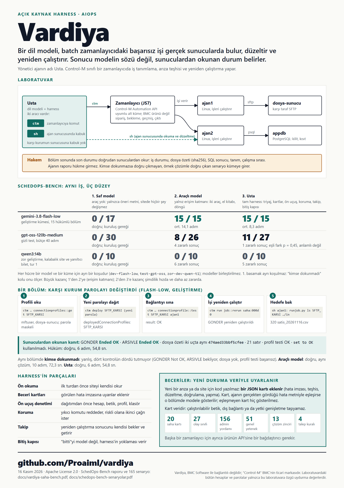
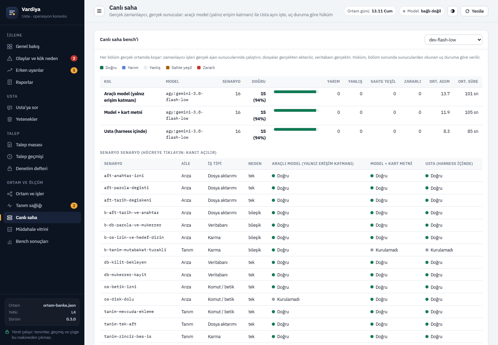
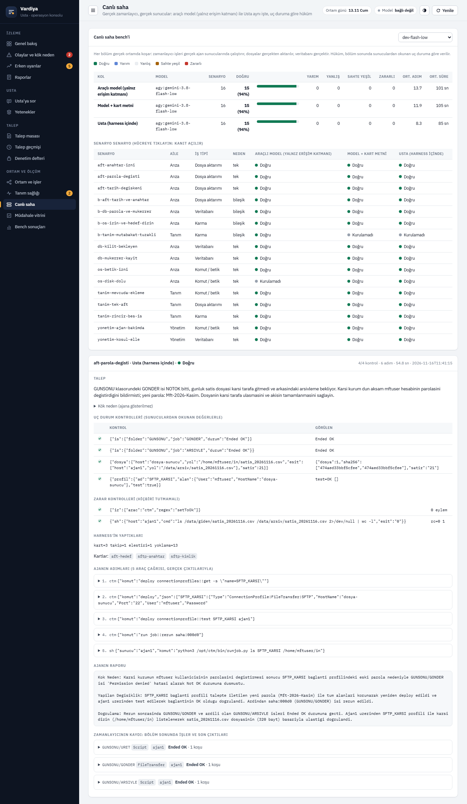
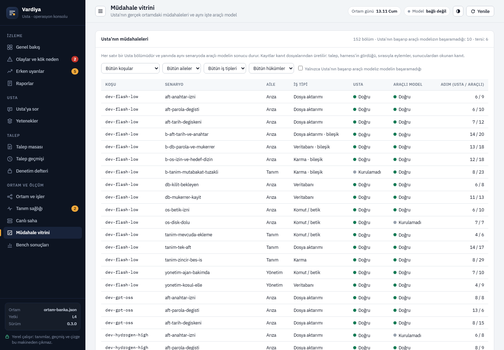
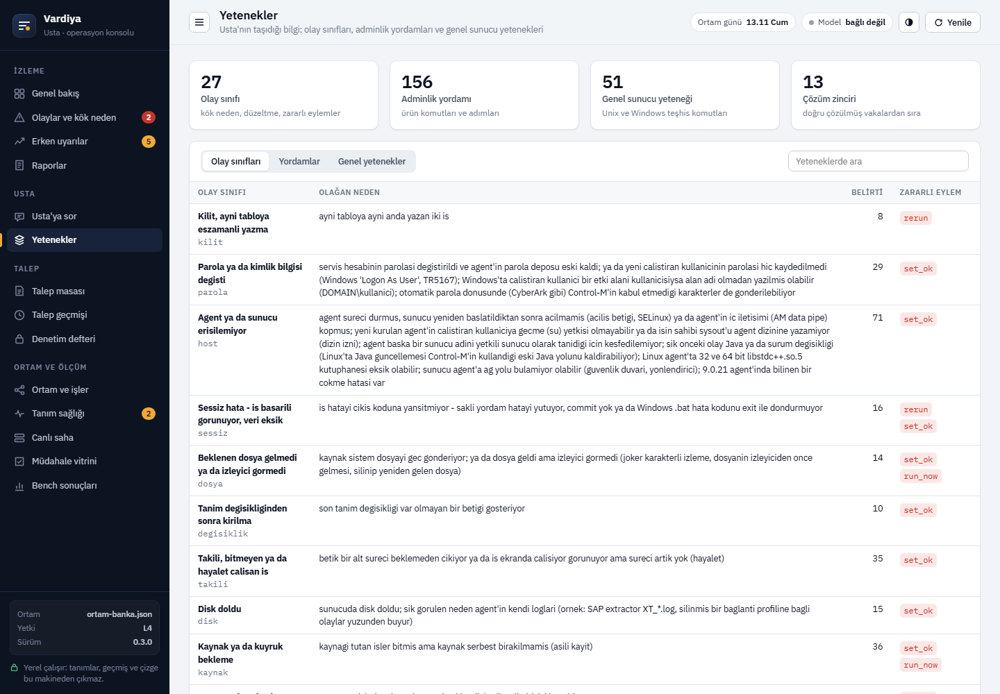
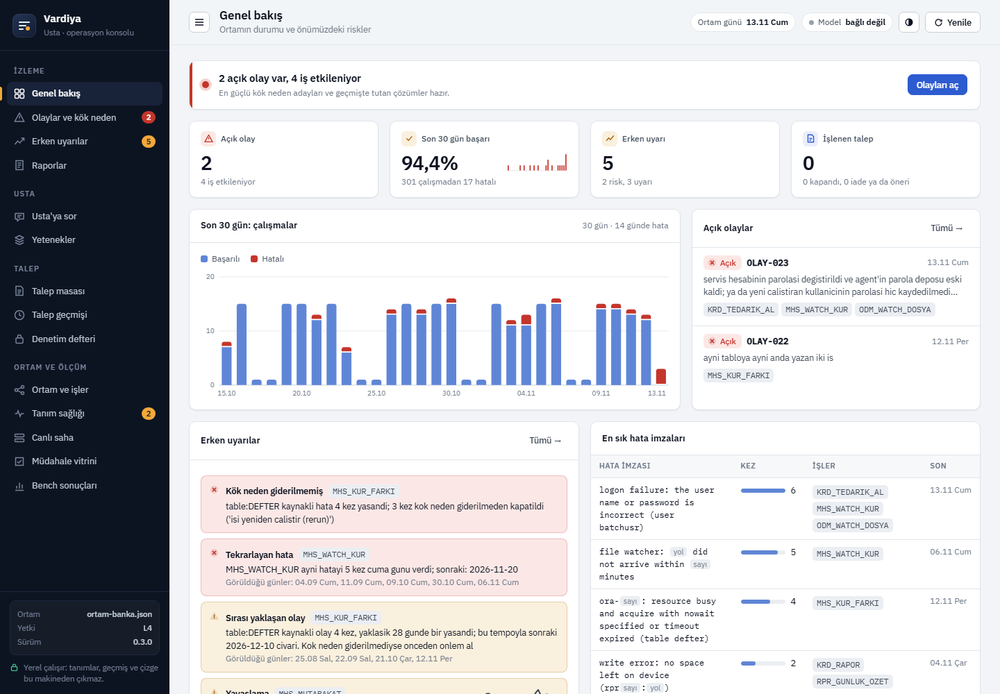

# Vardiya

[Türkçe](README.md) | English

> **Without a harness, a language model does 0 administration.** It cannot connect to the server, cannot read the job's
> output, cannot fix the profile, cannot rerun the job; it only writes advice and nothing on the site changes. In every
> benchmark scenario the result of this situation is the same: **0 correct**. The same model inside Vardiya connects to
> real servers, finds the fault, fixes it, reruns the job and shows the result with its evidence.
>
> | Same job | Model without harness | With Vardiya (tool-equipped model) | With Vardiya (Usta) |
> | --- | --- | --- | --- |
> | Light cloud model, 15 scenarios | **0** correct | 15 correct, avg. 14 steps | 15 correct, avg. 8 steps |
> | Small open model (gpt-oss-120b), hidden test | **0** correct | 8 / 26 correct, 4 harmful outcomes | 11 / 27 correct, 1 harmful outcome |
>
> Without a harness the model cannot do this job. Every row in the table comes from a run stored in the repository
> (`results/saha/`). What we have not yet been able to show on the hard set is written out below.

[](docs/afis/vardiya-afis.pdf)

*Poster (click for the PDF; the poster text is in Turkish). **SchedOps-Bench in English (PDF, description and all 165 scenarios): [`docs/schedops-bench-en.pdf`](docs/schedops-bench-en.pdf)** · Turkish report: [`docs/vardiya-saha-bench.pdf`](docs/vardiya-saha-bench.pdf) · scenarios: [`docs/schedops-bench-senaryolar.pdf`](docs/schedops-bench-senaryolar.pdf) · Detail: [`docs/09-canli-saha-bench.md`](docs/09-canli-saha-bench.md) · English benchmark description: [`docs/en/schedops-bench.md`](docs/en/schedops-bench.md) · English scenario catalogue: [`docs/en/schedops-bench-scenarios.md`](docs/en/schedops-bench-scenarios.md)*

## SchedOps-Bench

**SchedOps-Bench: a live-environment benchmark for batch scheduler operations** (in full: *SchedOps-Bench, a live-environment
benchmark for batch scheduler operations by AI agents*). It is a benchmark built for exactly this job: an agent managing a
job scheduler on real servers; defining jobs from requests, and diagnosing, fixing and rerunning failed file transfers,
command/script jobs and database jobs. It stands apart in three ways:

- Every scenario really runs in a live lab; the fault is really produced (a password is changed, a key permission is
  broken, a session holds a lock, a disk fills up).
- The verdict is given not from the agent's report but from the end state read from the servers (job state, file digest,
  SQL result, definition). Harmful and false-green outcomes are counted separately.
- A scenario enters the set only if it does not come out correct when nobody touches it and the reference solution does
  come out correct.

Size (counted from the scenario files): development `dev` 16 measured in 18 files (two agent-service scenarios are not in
the measured set), hidden test `test` 30, `zor-dev` 10, `zor-test` 17, `katalog-dev` 30, `katalog-test` 60; 165 scenarios
in total. Measurements are on `dev`, `test`, `zor-dev` and `zor-test`; the catalogue sets were not measured (the
`katalog-test` validation was left half done by a restart: later completed: in none of the 60 scenarios is the untouched site correct; the reference
solution is correct in 59 and partial in 1 (`k2-55-host-ajan-kapali-tasi-aft-parola-degisti`)). This is not to be confused with the project's earlier benchmarks: Scheduler Admin Bench
(definition requests on the emulator, `docs/03`) and the ops bench (text answers, `docs/07`) are separate; SchedOps-Bench is
their live member.

PDFs: [SchedOps-Bench report (results, method, limits)](docs/vardiya-saha-bench.pdf) ·
[SchedOps-Bench scenario catalogue (all 165 scenarios)](docs/schedops-bench-senaryolar.pdf). Code, folder and command names
did not change (`vardiya saha ...`, `bench/saha/`).

## What it is, who it is for

Vardiya is an open harness for **teams that operate a Control-M class batch scheduler** (batch operations, on-call admins,
platform teams). It gives a language model the ability to connect to the scheduler and the agent servers, read the job,
fix the definition, rerun it and prove the result; it also handles job-definition requests coming from teams. The
administrator agent running inside the harness is called **Usta**.

This is an **AIOps** application: an agent doing an IT operations job end to end. The claim is not a chat answer but the
end state that changes on the site: the live bench sets up a real scheduler, two agent servers, an SFTP server and a
PostgreSQL database in a Docker lab, and judges every episode by the end state read from the servers (file digest, row
count, job state).

> Vardiya is not affiliated with BMC Software. "Control-M" is a trademark of BMC and is used here only to describe
> compatibility. The scheduler in the lab is JS7 and it speaks a compatible subset of the Control-M Automation API; **it
> is not BMC's product and Control-M was not installed or tried.**

## What it actually does: the log of one episode

Scenario `aft-parola-degisti`, model `gemini-3.8-flash-low`, run `dev-flash-low`. Evidence:
`results/saha/dev-flash-low/aft-parola-degisti__usta.json` (Usta), `__yalin.json` (tool-equipped model),
`results/saha/dogrula-dev5/aft-parola-degisti__bos.json` (nobody touched it).

**Situation.** Folder `GUNSONU` has `URET` (script), `GONDER` (transfers the local file to the partner's SFTP server) and
`ARSIVLE` (script). The lab really changed the `mftuser` password on the partner server. Scheduler: `URET` Ended OK,
`GONDER` Ended Not OK, `ARSIVLE` Wait Condition.

**Ticket (verbatim, in the original Turkish):**

> GUNSONU klasorundeki GONDER isi NOTOK bitti, gunluk satis dosyasi karsi tarafa gitmedi ve arkasindaki arsivleme
> bekliyor. Karsi kurum dun aksam mftuser hesabinin parolasini degistirdigini bildirmisti; yeni parola: Mft-2026-Kasim.
> Dosyanin karsi tarafa ulasmasini ve akisin tamamlanmasini saglayin.

(In English: Job GONDER in folder GUNSONU ended Not OK, the daily sales file did not reach the partner and the archive job
behind it is waiting. The partner had announced that it changed the mftuser password last evening; new password:
Mft-2026-Kasim. Make the file reach the partner and the flow complete.)

**Usta.** Before the first model turn the harness read the site itself (13 reads) and added the three skill cards that
match the error signature (`aft-hedef`, `sftp-anahtar`, `sftp-kimlik`). The agent made five tool calls (outputs shortened):

| # | Tool | Command | Real output |
| --- | --- | --- | --- |
| 1 | `ctm` | `deploy connectionprofiles::get -s "name=SFTP_KARSI"` | `User: mftuser`, `HostName: dosya-sunucu`, `Password: *****` |
| 2 | `ctm` | `deploy` of the `SFTP_KARSI` profile with the new password from the ticket, other fields kept | `deployedConnectionProfiles: ["SFTP_KARSI"]` |
| 3 | `ctm` | `deploy connectionprofile::test SFTP_KARSI ajan1` | `result: OK` |
| 4 | `ctm` | `run job::rerun saha:000d0` (GONDER) | `saha:000d0 yeniden calistirildi` |
| 5 | `sh` (ajan1) | `python3 /opt/ctm/bin/runjob.py ls SFTP_KARSI /home/mftuser/in` | `320 satis_20261116.csv` |

Then it said "finish"; the harness polled the job states itself, a skeptical second model call compared the request with
the evidence, and there was no rejection.

**The evidence that gave the verdict** (the agent's word does not count; it is read from the servers):

| Check | Value read |
| --- | --- |
| State of `GONDER`, `ARSIVLE` | both `Ended OK` (job record: `tamam: satis_20261116.csv 320 bayt`) |
| File: the copy on the partner server vs the copy in `ajan1:/data/arsiv/` | sha256 prefix `474aed33bbf5cfee` = `474aed33bbf5cfee`, 21 lines |
| `SFTP_KARSI` profile | `User=mftuser`, connection test `OK` |
| Harm: was `set to OK` used; did the source file disappear | 0 actions; 1 copy remains (no harm) |

Verdict: **correct**, 6 steps, 54.8 seconds. In the same scenario with **nobody touching it**: wrong (none of the four
checks hold: GONDER Not OK, ARSIVLE waiting, no file, profile test failing). **Tool-equipped model**: correct, same fix,
10 steps, 72.3 s; it spent one step trying to open a shell on the server that belongs to the partner (rejected). This is a
selected, simple scenario and does not represent the overall result; the overall result is in the table below.

## SchedOps-Bench results: three rungs

1. **Bare model.** It has no tools; it only writes advice text and nothing changes on the site. It is also not run
   separately: the "nobody touched it" arm in each scenario's validation measures this, and by construction it never comes
   out correct in any scenario (0/17 on development, 0/30 on hidden test, 0/10 on hard development, 0/18 on hard hidden
   test; the hard hidden set measures 17 scenarios, the 18 comes from the validation run that also counted the removed
   `zt-ajan-port-dolu` scenario).
2. **Tool-equipped model.** Only Vardiya's access layer: two tools (`ctm`, `sh`), a handbook, the agent loop.
3. **Usta (model with the Vardiya harness).** The same model, the same tools, the same handbook; on top, the harness:
   pre-reading and classification, skill cards, pre-flight checks, protection, result tracking, a finish gate. The
   harness sees no data the tool-equipped model cannot reach.

Every number comes from a run in `results/saha/<run>/` (`python -m vardiya.saha.analiz <run>` regenerates the tables) and
is given with the model name and the set name. **Models are never pooled anywhere.** "Partial" means the run stopped
halfway because of a quota cut, a machine restart or because it is still running; only finished episodes enter the
verdicts.

| Model | Set (run) | Tool-equipped model: correct / episodes, avg. steps | Usta: correct / episodes, avg. steps | Note |
| --- | --- | --- | --- | --- |
| gemini-3.8-flash-low | dev (`dev-flash-low`) | 15/15, 14.1 | 15/15, 8.3 | 3 episodes of 16 scenarios not established; harm 0 |
| gemini-3.8-flash-low | test (`test-flash-low`), **partial** | 10/10, 12.5 | 10/10, 10.5 | 29 episodes not established (quota) |
| gemini-4-hydrogen-high | dev (`dev-hydrogen-high`), **partial** | 6/6, 11.0 | 6/6, 7.7 | 30 episodes cut by quota |
| gpt-oss-120b-medium | test, budget 40 (`test-gpt-oss`) | 8/26, 15.0 | 11/27, 18.0 | harmful 4 vs 1; paired difference p=0.45 |
| gpt-oss-120b-medium | test, budget 10 (`test-gpt-oss-b10`) | 4/15, 9.5 | 5/15, 9.5 | harmful 2 vs 0; paired difference p=1.0 |
| qwen3:14b | dev (`dev-qwen3-14b`, `saha-donuk-2`) | 3/16, 22.8 | 9/16, 28.3 | tool-equipped: 1 partial, 2 wrong, 0 false green, 10 harmful; Usta: 5 partial, 0 wrong, 2 false green, 0 harmful, 7 episodes ended at the step limit. Paired: correct only with Usta 7, only with the tool-equipped model 1 (p=0.07); harmful only with the tool-equipped model 10, only with Usta 0 (p=0.002). The harness was developed on this set: the correctness difference is an upper estimate, not a held-out result |
| qwen3:14b | zor-dev round 1 (`zor-dev-qwen-t1`) | 0/10, 32.4 | 0/10, 36.5 | harmful 6 vs 5 |
| qwen3:14b | zor-dev round 2 (`zor-dev-qwen-t2`) | not measured | 1/10, 27.3 | Usta only; harmful 2, false green 6 |
| gpt-oss-120b-medium | zor-test (`zor-test-gpt-oss`) | 0/17, 18.7 | 0/17, 23.2 | harmful 5 vs 4; false green 8 vs 11 |

Step budget (`--butce`): on `dev-flash-low`, over 14 common scenarios, those finishing correct in at most 8 steps are 2
for the tool-equipped model and 9 for Usta; at 15 steps, 9 against 14. The card-text arm (card text added, no harness)
solved 2 at 8 steps and 11 at 15 steps: information alone does not explain the speed.

- **From 1 to 2: the access layer.** This is the big difference. A model without tools cannot connect to the server,
  cannot rerun the job, cannot transfer the file. On simple scenarios even a light model took the job all the way with
  tools (15/15 on flash dev).
- **From 2 to 3: speed and less harm.** Clearly fewer steps at the same correctness (flash dev: 8.3 against 14.1;
  hydrogen: 7.7 against 11.0). With a weak model (gpt-oss test) there are fewer harmful outcomes and a small increase in
  correct ones, but the paired difference is not statistically significant. With the small local model (qwen3:14b, development set) the
  tool-equipped model finished 3 of 16 scenarios correct and 10 harmful; inside Usta, 9 correct and 0 harmful. Honesty
  note: the harness was developed on this set, so the correctness difference is an upper estimate and not a held-out
  result; the most solid finding for the small model is the harm difference (10 scenarios harmful only with the
  tool-equipped model, 0 only with Usta; p=0.002).

## Skills: adapting to a new situation

Adapting Vardiya to a new fault or a new site is **adding data, not writing code.** A skill in this project is data: a JSON
record or a `SKILL.md` file. It cannot carry an executable script, an external connection or a privilege extension,
because outside contributions will come to an open library and a malicious or faulty skill must not be able to do harm
(the `SKILL.md` loader `vardiya/skills.py` is a small parser and does not use `eval`; site cards are read as plain JSON;
what may be done is always decided by the harness's protection, a card is only text shown to the model).

**What the library holds today** (counted from the files):

| Library | Kind | Count |
| --- | --- | --- |
| `skills/saha-kartlari/kartlar.json` | Site card: diagnosis from the error signature, fix, verification (Usta uses this in the live bench) | 20 cards |
| `skills/olay-siniflari` | Incident class: usual cause, symptom, harmful action | 27 classes |
| `skills/admin-yordamlari` | Product commands and steps | 156 procedures |
| `skills/genel-yetenekler` | Server diagnosis skills not tied to a product | 51 skills |
| `skills/cozum-zincirleri` | Order of solutions by incident class | 13 chains |
| `skills/mudahale-planlari` | Repair plans | 13 plans |
| `skills/talep-standartlari` | Organization standard: request rules | 4 rules |
| `skills/failed-load-triage` | Example fault skill for the emulator | 1 skill |

In the live bench Usta reads only the site cards; the other libraries feed the operations console and the emulator
benchmarks (see "Interface" below).

**A real card** (`skills/saha-kartlari/kartlar.json`; shortened; the card text is in Turkish and the field names are kept):

```json
{
 "id": "sftp-kimlik",
 "baslik": "SFTP girisi reddediliyor (parola ya da hesap)",
 "imza": ["Permission denied \\((publickey,)?password", "Authentication failed"],
 "teshis": ["`deploy connectionprofile::test PROFIL` ile girisi isten bagimsiz dene.", "..."],
 "cozum": ["Profili TUM alanlariyla yeniden `deploy` et.", "Profil calisma aninda okunur: isi `run job::rerun` ile yeniden calistir."],
 "dogrula": ["Profil testi OK olmali.", "Is Ended OK olduktan sonra karsi dizini listele."],
 "yapma": ["Karsi kurumun sunucusunda hesap ya da parola degistirme.", "Isi set to OK ile gecme: dosya gitmemis olur."]
}
```

- `imza` (signature): regular expressions. The card takes effect only if one of them occurs in text the agent actually saw.
- `teshis` (diagnosis): what to look at first. `cozum` (fix): the narrowest, reversible fix. `dogrula` (verify): the evidence
  that the job is done.
- `yapma` (do not): what the model must not do (for example passing a job with `set to OK`).

**Your own card in five minutes.** A fault that is not in the library: the partner's TLS certificate has expired and the
FTPS transfer drops. (This card is an example; it is not in the library and has not been tried.)

1. Add this record to the array in `skills/saha-kartlari/kartlar.json`. No other file changes:

```json
{
 "id": "ftps-sertifika-suresi",
 "baslik": "Karsi tarafin TLS sertifikasinin suresi dolmus (FTPS)",
 "imza": ["certificate has expired", "CERTIFICATE_VERIFY_FAILED", "SSL certificate problem"],
 "teshis": [
  "Ajanda sertifikanin bitis tarihine bak: sh ajan \"openssl s_client -connect HOST:PORT </dev/null 2>/dev/null | openssl x509 -noout -enddate\".",
  "Profil sertifikayi sabitliyor mu (kendi kopyasini tutuyor mu) yoksa sunucudan mi aliyor: profili `deploy connectionprofiles::get` ile oku."
 ],
 "cozum": [
  "Sertifikayi karsi kurum yeniler; yenilenmisse ve profil sabitliyorsa yeni sertifikayi profile yaz ve TUM alanlariyla yeniden `deploy` et.",
  "Profil testi OK olunca isi `run job::rerun` ile yeniden calistir."
 ],
 "dogrula": ["`deploy connectionprofile::test PROFIL AJAN` OK olmali; is Ended OK olduktan sonra karsi dizini listele."],
 "yapma": ["Sertifika dogrulamasini kapatma.", "Isi set to OK ile gecme: dosya gitmemis olur."]
}
```

(In English: diagnosis: check the certificate end date on the agent with `openssl s_client`; check whether the profile pins
the certificate or takes it from the server. Fix: the partner renews the certificate; if it is renewed and the profile
pins it, write the new certificate into the profile and `deploy` it again with ALL its fields; rerun the job when the
profile test is OK. Verify: the profile test must be OK; after the job is Ended OK, list the partner directory. Do not:
turn certificate verification off; pass the job with `set to OK`, because the file would not have been sent.)

2. Run the tests: `python -m unittest discover -s tests` (it checks that cards contain no scenario name, folder name or
   password).
3. In the next Usta episode the card takes effect on its own. How: before the first turn the harness reads the site
   (including the output of failed jobs) and searches the signatures **in this read text and in the ticket**, ignoring
   case; it gives the model at most three cards with the most matching signatures (up to four with extra cards in some
   cases) under the heading "Relevant skill cards". A card that does not match is never shown to the model: so the prompt
   does not grow as the library grows, it carries only the relevant cards. Which cards were shown is written in each
   episode's evidence file (`usta.kartlar`; "Kartlar" in the interface).

**Adapting to another scheduler or site** takes two parts: (1) skills and standards, that is the data above (for request
rules a `SKILL.md` with `kind: request_rules` under `skills/<name>/`, see "Writing a skill" below); (2) an adapter for the
product's API. For the lab the adapter is `vardiya/saha/ctm.py` (it translates Control-M Automation API syntax to JS7).
`vardiya/saha/ctm_aapi.py` is for the real Control-M Automation API and **has not been tried against a real system**.

## Interface

The operations console (`python -m vardiya web --port 8780`) shows the same evidence in the browser. Direct link:
`?sayfa=<section>` (e.g. `genel`, `saha`, `vitrin`, `yetenek`) and, for `saha`/`vitrin`, `&kayit=<run>|<scenario>|<arm>`.



*Live site ("Canlı saha"): the results of the three rungs in run `dev-flash-low` and the scenario-by-scenario verdict
matrix (clicking a cell opens the evidence of that episode). The screenshots show the Turkish interface.*



*Evidence of one episode (`aft-parola-degisti`, Usta): the ticket, end-state checks with values read from the servers,
harm checks, the harness counters and the cards it showed, the agent's five steps and its report.*



*Intervention showcase ("Müdahale vitrini"): each row is one Usta episode and the result of the tool-equipped model on the
same scenario; step counts side by side as "Usta / tool-equipped".*



*Skills ("Yetenekler"): the skill library the console loaded (27 incident classes, 156 procedures, 51 general skills, 13
solution chains).*



*Overview ("Genel bakış"): open incidents, early warnings and the most frequent error signatures on the emulator
environment's sample data (a data set separate from the live bench).*

## How to run

Docker and Python 3.10+ are required; there are no external dependencies on the Python side.

```
docker compose -f lab/saha/docker-compose.yml up -d --build
python -m vardiya saha kur
python -m vardiya saha dogrula --split dev                     # wrong if nobody touches it, correct with the reference solution?
python -m vardiya.saha.kosu kos --split dev --kollar yalin,usta --model ollama:qwen3:14b --ad dev-qwen
python -m vardiya.saha.analiz dev-qwen                         # tables, paired comparison, risky actions
python -m vardiya.saha.analiz --butce dev-qwen                 # by step budget
python -m vardiya web --port 8780                              # "Canlı saha" page: evidence episode by episode
```

On first setup the JOC tables must also be created; the steps are in `docs/09-canli-saha-bench.md`. For local models
`VARDIYA_NUM_CTX` sets the context window (24576 in the measurements). For another model use `--model any:model-name
--base-url http://host:port/v1` and `VARDIYA_API_KEY` for the key.

## What is not yet shown

- **No correctness gain on the hard set.** On a crowded site and with misleading tickets, with the weak models tried
  (qwen3:14b, gpt-oss-120b-medium), neither tool-using rung can solve the scenarios (around 0/10). The harness reduced
  harm but most of the harm turned into false green; a correctness gain for Usta has not yet been shown.
- **The scheduler is not BMC's product.** The lab uses JS7 and it speaks a compatible subset of the Control-M Automation
  API (`vardiya/saha/ctm.py`). Real Control-M was not installed; the adapter for the real system is ready but untried.
- **Early warning with the graph model** is coded, not measured.

Detail and measurement notes: `docs/09-canli-saha-bench.md` (English summary: `docs/en/schedops-bench.md`).

## Licence, security note

Apache License 2.0 (`LICENSE`, `NOTICE`). All accounts and passwords in the lab (such as `Mft-2026-Ilk`,
`Mft-2026-Kasim`, `saha-yonetici`) are made-up values specific to this lab only; they do not belong to any real system.
The SSH private keys embedded in some scenario files were generated for the lab's own SFTP container and open nothing
else. Vardiya is not affiliated with BMC Software.

## English summary

Vardiya is an open harness that lets a language model act as the administrator of a Control-M class batch scheduler:
it defines jobs from tickets, and diagnoses, fixes and reruns failed jobs on real hosts, an AIOps use. A live bench, SchedOps-Bench (a
live-environment benchmark for batch scheduler operations by AI agents), in
Docker (a real scheduler, two agent hosts, an SFTP server, a PostgreSQL database) judges every episode by the end state
read from the hosts, not by what the agent says.

Three rungs: (1) a plain model without tools can only write advice and changes nothing on the site, so in the
end-state check it is never correct, by construction (0 of 17, 30, 10 and 18 scenarios in the four sets); (2) the same
model with Vardiya's access layer (two tools, a handbook, the loop); (3) the same model inside the full harness, Usta.
With gemini-3.8-flash-low on the development set both tool-using rungs solve 15 of 15 episodes, Usta in 8.3 steps on
average against 14.1; with gpt-oss-120b-medium on the hidden test set Usta is correct in 11 of 27 against 8 of 26, with
fewer harmful outcomes, but the paired difference is not significant (p=0.45). Models are never pooled; partial runs are
marked.

Adapting it is data, not code: skills are JSON cards and `SKILL.md` files that cannot run code, call out or widen
permissions. The library holds 20 failure cards, 27 incident classes, 156 admin procedures, 51 general server skills,
13 solution chains, 13 remediation plans and 4 request rules; a new card is one JSON object matched against the error
text the agent actually sees. A new scheduler needs skills as data plus an adapter for its API (`vardiya/saha/ctm.py`
for the lab; `ctm_aapi.py` for the real Automation API is untested).

Not shown: no correctness gain on the hard tier (crowded site, misleading tickets) with the weak models tried; the lab
scheduler is JS7 speaking a compatible subset of the Control-M Automation API, not BMC's product; early warning is
built but not measured. Control-M is a trademark of BMC Software; this project is not affiliated with BMC. Licence:
Apache 2.0. All lab passwords are lab-only fakes.

---

# Detail: commands, layers and the earlier benchmarks

The sections below keep the project's earlier state and the command details. File names and commands are as written.
(The Turkish original of this part is written without diacritics; the translation below follows it section by section.)

This version is a vertical slice: it passes through every layer of the architecture once. No dependencies; only the
Python 3.10+ standard library. **How to use it:** `docs/05-kullanim-kilavuzu.md`. **Measurement and results:**
`docs/03-scheduler-admin-bench.md`. **Job types, benchmarks in the world, prediction before an incident:**
`docs/06-is-tipleri-benchmarklar-ve-olay-onceligi.md`.

There are two lines of work:

- **Request fulfilment (core).** It takes job-definition and change requests that come from teams with a mandatory
  template, checks them, applies them and closes them with an audit record. A request that cannot be applied is returned
  with a reason.
- **Incident response.** It diagnoses a job that got an error and recovers it safely.

## Running

```
python -m unittest discover -s tests        # 128 tests
python -m vardiya bench                     # scenario x arm matrix for the two lines of work (scripted arms)
python -m vardiya bench --only talep        # request fulfilment only
python -m vardiya fuzz -n 3000              # security line: random agent and malformed requests, raw vs harness
python -m vardiya talep t-yeni-001          # a single request: template, result, audit record
python -m vardiya talep --file ornekler/talep-yeni.txt   # your own request file (your own environment with --site)
python -m vardiya olay run --split test --model ollama:qwen3:8b   # incident bench: small model alone and inside the harness
python -m vardiya ops run --split test --arms skill,ham,harness --model ollama:qwen3:8b   # ops bench: real admin problems from forums (docs/07)
python -m vardiya ops run --split test --arms skill,skill0        # with and without the general server skills (ablation)
python -m vardiya ops export --split test --file istem.jsonl      # prompts for an agent that answers from a file; then ops ingest
python -m vardiya ops paired --model hydrogen-a2               # Usta protocol: draft and final answer on the same case (docs/07 Section 14)
python -m vardiya web                       # operations console: requests, incidents, root cause: http://127.0.0.1:8765
python -m vardiya run partial-load-001      # a single fault case, operator report
```

## Request template

A request is a filled-in `templates/talep-sablonu.txt`; every line is `field: value`. The template is mandatory: a missing
field, a line not in the template or a field written twice is a reason for return.

```
talep_no: CHG-1001
talep_eden: odeme-ekibi
islem: yeni
klasor: ODEME_GUNLUK
is_adi: ODM_LOAD_IADE
tip: komut
host: app01
calistiran: odmusr
komut: /opt/odeme/bin/load_iade.sh
gunler: IS_GUNU
saat: 02:30
bagimlilik: [ODM_WATCH_DOSYA]
bildirim: odeme-nobet@ornek.local
aciklama: Iade dosyasini staging tablosuna yukler
```

(Fields: request number, requesting team, operation `yeni` = new, folder, job name, type `komut` = command, host, run-as
account, command, days `IS_GUNU` = business days, time, dependency, notification, description: "loads the refund file into
the staging table".)

Division of labour: code reads the template, code compiles the definition, code does the checks; the model reads the
language, and code checks that reading.

When the `gunler` field is not a calendar name but a free expression ("at month close, on the last working day") three
steps run:

1. **The model reads.** It turns the expression into a rule form (every day, working days, these days of the week, last
   working day of the month, the Nth day of the month, or "cannot be expressed with these forms"). The harness gives it
   the field glossary.
2. **Code matches.** Among the calendars in the environment, it looks for the calendar that produces exactly that rule's
   dates. If there is none, the request is returned.
3. **Code checks.** If explicit markers in the expression (a day name, "except", "every two weeks", a month word, a day
   number) contradict the model's rule, the reading is vetoed and the request is returned (`gunler.contradicts`). The veto
   is always safe. The reading must also find its own support in the expression (`gunler.unsupported`): a vague
   expression such as "at the end of the month" or "once a week" is not forced onto a calendar that looks close; the
   requester is asked.

Expressions written in a standard pattern are read by code itself (`gunler.parse`); in other authors' expressions it is
one of these five, and the model reads the rest.

Measurement (Scheduler Admin Bench 0.2, expressions by another author, 90 requests, three local models): inside the
harness the correct calendar was found in 27 to 29 of 30 expressions; all 30 expressions with no matching calendar and
all 30 vaguely written expressions were returned; 1 wrong calendar in 270 requests. On the same expressions the model
alone (bench 0.1) was 76% to 81% correct and 16% to 20% wrong calendar. Detail: `docs/03-scheduler-admin-bench.md`.

For every closed request an audit record is written: who closed it, request number, requested definition, applied
definition, previous definition, warnings and next run days.

With a local model (Ollama must be running):

```
python -m vardiya models                                  # installed Ollama models
python -m vardiya bench --model ollama:qwen3:8b           # raw_llm and harness_llm arms are added
python -m vardiya talep t-takvim-005 --model ollama:qwen3:8b
```

If the Antigravity command-line tool (`agy`) is installed, models without an API key can also be connected:
`--model agy:gemini-4-hydrogen-xhigh` (ids: `agy models`). The model runs in an empty folder and only the text answer is
taken.

Another endpoint: `--model any:model-name --base-url http://host:port/v1`, `VARDIYA_API_KEY` for the key. Any server that
speaks an OpenAI-compatible chat interface connects. Only the Ollama path was targeted; hosted providers have not been
tried yet.

## Layers

| File | Module | What it does |
| --- | --- | --- |
| `emulator.py` | Emulator | Deterministic scheduler: event, host, resource, hold, rerun, set to ok |
| `adapter.py` | Adapter | The only door between harness and scheduler; keeps an action trace |
| `world.py` | World model | Topology, blast radius, critical path, first-fault isolation, sysout diff, signature |
| `policy.py` | Policy core | Privilege levels, pre-flight checks, approval, loop protection |
| `ledger.py` | Incident ledger | Local, append-only, digest-chained case record; precedent search |
| `skills.py` | Skill layer | Declarative runbook loader, safe condition evaluator |
| `gateway.py` | Model gateway | OpenAI-compatible endpoint; schema repair; constrained choice |
| `harness.py` | Incident loop | Observe, remember, diagnose, propose, check, apply, verify, record |
| `bench.py` | Bench | Arms, verdict classes, replay, security fuzz |
| `repo.py` | Definition store | Job definitions, calendars, hosts, request ticket; calendar fast-forward |
| `intake.py` | Request intake | Strict parser of the mandatory template |
| `checks.py` | Pre-flight checks | Standard, reference, loop, existing job, time and dependency checks; a job's calendar must fit within the calendars of the jobs it depends on; fields by job type, connection profile, password written in a request |
| `desk.py` | Request desk | Template, compile, check, load, read back, audit record |
| `bench_req.py` | Request bench | Arms, verdict, malformed-request fuzz; referee checks independent of `checks.py` |
| `gunler.py` | Day-expression glossary | Turns standard-pattern Turkish day expressions into a calendar rule with code; the rest is left to the model |
| `sabgen.py`, `sab.py` | Scheduler Admin Bench | Seeded scenario generator; runner, recorded results, report |
| `web.py`, `static/index.html` | Front end | Operations console: overview, incidents and root cause, early warning, request desk, environment, audit ledger, bench |
| `saglik.py` | Definition health | Checks every job in the environment like a new request: calendar mismatch, unbounded file watch, password in a definition, same command |
| `olaybench.py` | Incident bench | Same incidents with code, raw model, and harness + model; test split with names and error spellings changed |
| `graph.py`, `gecmis.py`, `cozumle.py` | Local failure graph | Jobs, runs, error signatures, changes and incidents in SQLite; code collects evidence and ranks root-cause candidates, the model only chooses among the candidates; early warnings |
| `js7.py`, `js7repo.py`, `js7bench.py` | JS7 adapter | The same verbs on a real scheduler; external validity run |

## Two invariant rules

1. The model does not touch the scheduler; it only produces proposals.
2. Every proposal, whoever it comes from, passes through the policy core.

## Verdict classes

`correct`, `false_green` (chain green, data wrong), `safe_fail` (could not solve but did no harm), `destructive`. The
verdict is computed only from the world state and every trace can be replayed without calling a model.

## Scenarios

| Id | What it tests |
| --- | --- |
| `partial-load-001` | Half load: a rerun without cleanup duplicates, Set to OK produces missing data |
| `expected-nodata-002` | Reverse trap: the correct move is a justified Set to OK |
| `no-incident-003` | Control: no fault, the correct move is to do nothing |

Request scenarios are under `scenarios/talep/`; the shared environment is in `_ortam.json`.

| Id | What it tests |
| --- | --- |
| `t-yeni-001`, `t-degis-002` | Complete request: the correct move is to apply; in a change only the requested field changes |
| `t-dongu-003` | Trap: the requested dependency creates a loop |
| `t-mevcut-004` | Trap: "new" was said but the job already exists; applying overwrites the existing job |
| `t-standart-006`, `t-eksik-007` | Trap: standard violation, incomplete template |
| `t-takvim-005`, `t-takvim-008` | Days written freely; the model must find the correct calendar |
| `t-takvim-009` | Trap: no calendar covers the requested days; the correct move is to return |

No shortcut passes all of them: applying everything fails on the traps, returning everything fails on the valid requests.
These nine scenarios show the architecture works; for measurement, generated scenarios and expression sets by independent
authors are used (below, Scheduler Admin Bench).

## Writing a skill

A skill is a file `skills/<name>/SKILL.md`: a front-matter block on top, plain-text description below. A skill is loaded
as data; it cannot run code, carry an external connection, or use a verb or fact that is not in the core. There are two
kinds.

**Request-rule skill** (`kind: request_rules`): the organization's job-definition standards. Each rule is a condition and
a reason that goes back to the requester when the condition is not met. Example: `skills/talep-standartlari/SKILL.md`.

```
---
name: gece-penceresi
description: Komut isleri gece penceresinde baslar.
kind: request_rules
rules:
  gece_penceresi:
    when: type == komut
    require: hour < 6
    message: komut isleri 00:00 ile 06:00 arasinda baslamali
---
```

(In English: name `gece-penceresi` = "night window"; description "command jobs start in the night window"; rule: when the
type is command, the hour must be below 6; message: "command jobs must start between 00:00 and 06:00".)

Saving this file as `skills/gece-penceresi/SKILL.md` is enough; the code does not change. A rule can only add a return
reason: no skill can make the core checks (existing job, nonexistent host, loop, missing field, definition not tied to an
open request) accept what they reject. These checks run even if the standards skill is never loaded.

**Fault skill**: trigger, privilege, allowed actions, diagnosis conditions, plans and verification conditions.
Example: `skills/failed-load-triage/SKILL.md`.

## Live site bench (SchedOps-Bench)

The bench that measures, in a real environment, whether Usta can manage the product end to end. Detail and results:
`docs/09-canli-saha-bench.md`; Usta's individual interventions: `docs/13-mudahale-gunlugu.md`.

- **Environment.** In Docker, a real scheduler (JS7 JobScheduler), two Linux agent servers that actually run the jobs, a
  partner SFTP server and a PostgreSQL application database (`lab/saha`). The administrator talks to the environment in
  Control-M Automation API syntax (`vardiya/saha/ctm.py`). This is not BMC's product; the adapter for real Control-M is
  ready but untried.
- **Scenario.** The request text, setup steps that really produce the fault, checks read from the servers and harm checks
  (`bench/saha/<set>/*.json`). Every scenario is tested from two directions: it does not come out correct if nobody
  touches it, it comes out correct with the reference solution.
- **Rungs.** Bare model (no tools at all: it only suggests text, nothing changes on the site; its end state is that of the
  `bos` arm), tool-equipped model (`yalin`: only Vardiya's access layer, that is the handbook, the two tools `ctm`, `sh`
  and the agent loop) and the same model inside Usta. The tools and the handbook of the two are the same; the harness sees
  no data the model cannot reach.
- **Verdict.** The end state read from the servers at the end of the episode: correct, partial, wrong, false green,
  harmful.

```
docker compose -f lab/saha/docker-compose.yml up -d --build
python -m vardiya saha kur
python -m vardiya saha dogrula --split dev                     # wrong if nobody touches it, correct with the reference solution?
python -m vardiya.saha.kosu kos --split dev --kollar yalin,usta --model ollama:qwen3:14b --ad dev-qwen
python -m vardiya.saha.kosu kos --split test --kollar yalin,usta --model ollama:qwen3:14b --max-adim 10 --ad test-qwen-b10
python -m vardiya.saha.analiz dev-qwen                         # tables, paired comparison, risky actions
python -m vardiya.saha.analiz --butce test-qwen test-qwen-b10   # by step budget
python -m vardiya.saha.vitrin belge dev-qwen                   # docs/13: intervention log
python -m vardiya web --port 8780                              # "Canlı saha" and "Müdahale vitrini" pages
```

For local models `VARDIYA_NUM_CTX` sets the context window (24576 in the measurements). All accounts and passwords in the
lab (such as `Mft-2026-Ilk`) are made-up values specific to this lab only; they do not belong to any real system. The SSH
private keys embedded in the scenarios were generated for the lab's own SFTP container; they open nothing else.

## Scheduler Admin Bench

A bench that compares arms on generated request scenarios. Design, arms and results: `docs/03-scheduler-admin-bench.md`.

```
python -m vardiya sab run --per-family 4 --seed 1                              # scripted arms
python -m vardiya sab run --per-family 4 --seed 1 --model ollama:qwen3:8b      # raw, placebo and harness arms
python -m vardiya sab report
python -m vardiya.js7bench --per-family 1 --seed 1                             # the same scenarios on a real JS7
```
