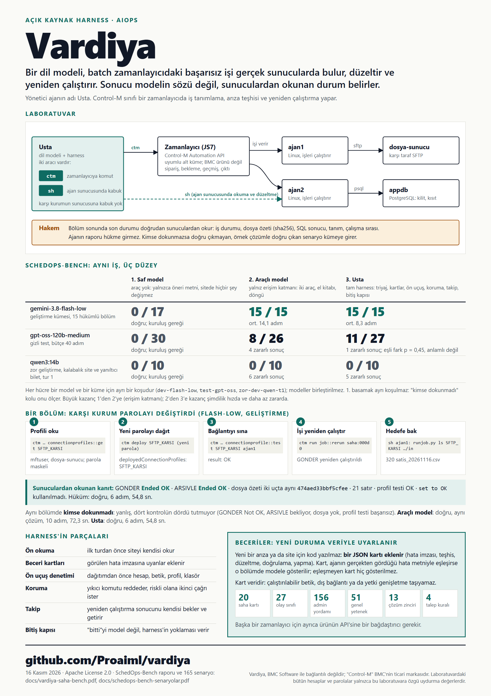
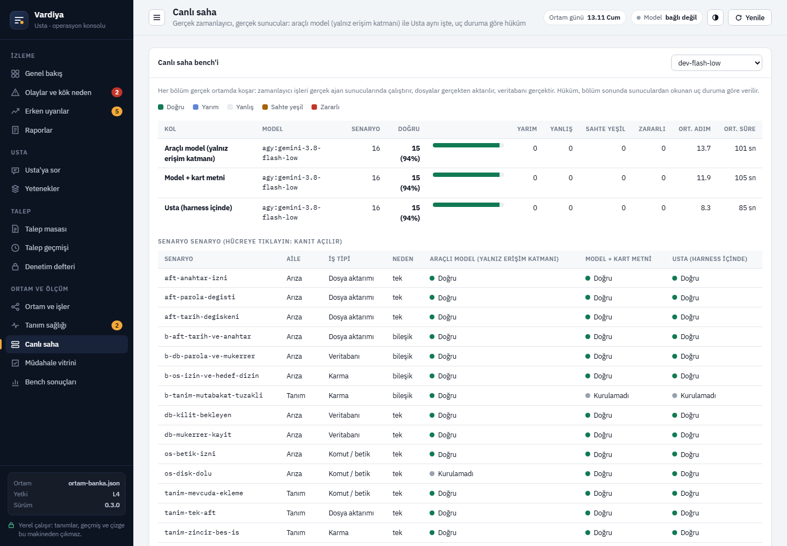
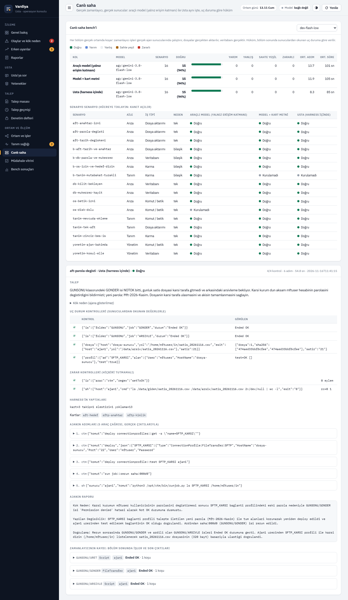
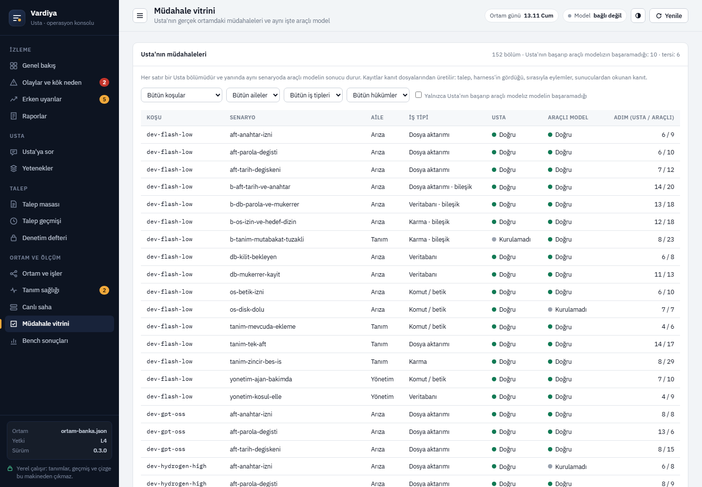
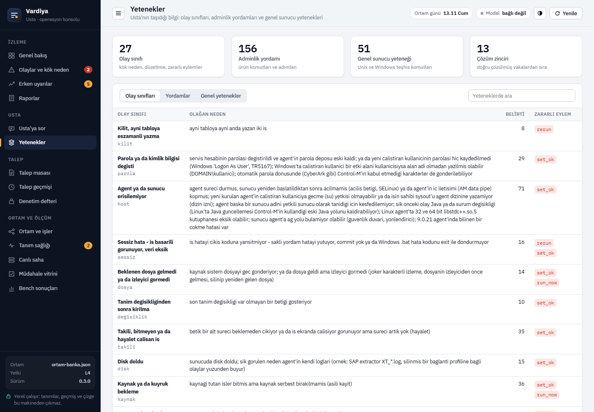
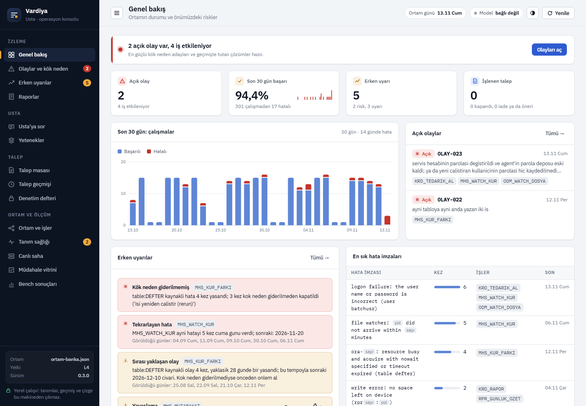

# Vardiya

Türkçe | [English](README.en.md) · [SchedOps-Bench in English (PDF)](docs/schedops-bench-en.pdf)

> **Harness olmadan bir dil modeli 0 adminlik yapar.** Sunucuya bağlanamaz, işin çıktısını okuyamaz, profili düzeltemez,
> işi yeniden çalıştıramaz; yalnızca öneri yazar ve sahada hiçbir şey değişmez. Bench'teki her senaryoda bu durumun
> sonucu aynıdır: **0 doğru**. Aynı model Vardiya'nın içinde gerçek sunuculara bağlanır, arızayı bulur, düzeltir, işi
> yeniden çalıştırır ve sonucu kanıtıyla gösterir.
>
> | Aynı iş | Harness'siz model | Vardiya ile (araçlı model) | Vardiya ile (Usta) |
> | --- | --- | --- | --- |
> | Hafif bulut modeli, 15 senaryo | **0** doğru | 15 doğru, ort. 14 adım | 15 doğru, ort. 8 adım |
> | Küçük açık model (gpt-oss-120b), gizli test | **0** doğru | 8 / 26 doğru, 4 zararlı sonuç | 11 / 27 doğru, 1 zararlı sonuç |
>
> Harness yoksa model bu işi yapamaz. Tablodaki her satır depodaki bir koşudan gelir (`results/saha/`). Zor kümede
> henüz gösteremediklerimiz aşağıda açıkça yazılı.

[](docs/afis/vardiya-afis.pdf)

*Afiş (PDF için tıklayın). SchedOps-Bench raporu: [`docs/vardiya-saha-bench.pdf`](docs/vardiya-saha-bench.pdf) · senaryolar: [`docs/schedops-bench-senaryolar.pdf`](docs/schedops-bench-senaryolar.pdf) · Ayrıntı: [`docs/09-canli-saha-bench.md`](docs/09-canli-saha-bench.md)*

## SchedOps-Bench

**SchedOps-Bench: batch zamanlayıcı operasyonları için canlı ortam benchmark'ı** (İngilizce: *SchedOps-Bench, a live-environment
benchmark for batch scheduler operations by AI agents*). Tam bu iş için kurulmuş bir benchmark'tır: bir ajanın gerçek
sunucularda bir iş zamanlayıcıyı yönetmesi; taleplerden iş tanımlamak, başarısız dosya aktarımı, komut/betik ve veritabanı
işlerini teşhis etmek, düzeltmek ve yeniden çalıştırmak. Üç şeyle ayrışır:

- Her senaryo canlı bir laboratuvarda gerçekten çalışır; arıza gerçekten üretilir (parola değişir, anahtar izni bozulur,
  oturum kilit tutar, disk dolar).
- Hüküm ajanın raporundan değil, sunuculardan okunan son durumdan verilir (iş durumu, dosya özeti, SQL sonucu, tanım).
  Zararlı ve sahte yeşil sonuçlar ayrı sayılır.
- Bir senaryo kümeye ancak kimse dokunmadığında doğru çıkmıyor ve örnek çözüm doğru çıkıyorsa girer.

Boyut (senaryo dosyalarından sayıldı): geliştirme `dev` 18 dosyada 16 ölçülen (iki ajan servisi senaryosu ölçülen kümede
yok), gizli test `test` 30, `zor-dev` 10, `zor-test` 17, `katalog-dev` 30, `katalog-test` 60; toplam 165 senaryo.
Ölçümler `dev`, `test`, `zor-dev` ve `zor-test` üzerindedir; katalog kümeleri ölçülmedi (`katalog-test` doğrulaması
yeniden başlatmada yarım kaldı: 60 senaryodan 49'unda geçen bir çift satır var, 1'i kurulamadı, 10'unda satır yok).
Bu, projenin önceki bench'leriyle karıştırılmasın: Scheduler Admin Bench (emülatörde tanım talepleri, `docs/03`) ve ops
bench (metin cevapları, `docs/07`) ayrıdır; SchedOps-Bench onların canlı üyesidir.

PDF'ler: [SchedOps-Bench raporu (sonuçlar, yöntem, sınırlar)](docs/vardiya-saha-bench.pdf) ·
[SchedOps-Bench senaryo kataloğu (165 senaryonun tamamı)](docs/schedops-bench-senaryolar.pdf). Kod, klasör ve komut adları
değişmedi (`vardiya saha ...`, `bench/saha/`).

## Nedir, kimin için

Vardiya, **Control-M sınıfı bir batch zamanlayıcıyı işleten ekipler** (batch operasyonu, nöbetçi adminler, platform
ekipleri) için açık bir harness'tir. Bir dil modeline zamanlayıcıya ve ajan sunucularına bağlanma, işi okuma, tanımı
düzeltme, yeniden çalıştırma ve sonucu kanıtlama yeteneği verir; ekiplerden gelen iş tanımlama taleplerini de karşılar.
Harness'in içinde çalışan yönetici ajanın adı **Usta**'dır.

Bu bir **AIOps** uygulamasıdır: bir ajanın BT operasyonu işini uçtan uca yapması. İddia bir sohbet cevabı değil, sahada
değişen son durumdur: canlı bench, bir Docker laboratuvarında gerçek bir zamanlayıcı, iki ajan sunucusu, bir SFTP
sunucusu ve bir PostgreSQL veritabanı kurar ve her bölümü sunuculardan okunan son durumla (dosya özeti, satır sayısı,
iş durumu) hükme bağlar.

> Vardiya, BMC Software ile bağlantılı değildir. "Control-M" BMC'nin ticari markasıdır; burada yalnızca uyumluluğu
> anlatmak için kullanılır. Laboratuvardaki zamanlayıcı JS7'dir ve Control-M Automation API'nin uyumlu bir alt kümesini
> konuşur; **BMC'nin ürünü değildir ve Control-M kurulup denenmedi.**

## Gerçekten ne yapıyor: bir bölümün dökümü

Senaryo `aft-parola-degisti`, model `gemini-3.8-flash-low`, koşu `dev-flash-low`. Kanıt:
`results/saha/dev-flash-low/aft-parola-degisti__usta.json` (Usta), `__yalin.json` (araçlı model),
`results/saha/dogrula-dev5/aft-parola-degisti__bos.json` (kimse dokunmadı).

**Durum.** `GUNSONU` klasöründe `URET` (betik), `GONDER` (yerel dosyayı karşı tarafın SFTP sunucusuna aktarır) ve
`ARSIVLE` (betik) var. Laboratuvar karşı sunucudaki `mftuser` parolasını gerçekten değiştirdi. Zamanlayıcı: `URET`
Ended OK, `GONDER` Ended Not OK, `ARSIVLE` Wait Condition.

**Bilet (olduğu gibi):**

> GUNSONU klasorundeki GONDER isi NOTOK bitti, gunluk satis dosyasi karsi tarafa gitmedi ve arkasindaki arsivleme
> bekliyor. Karsi kurum dun aksam mftuser hesabinin parolasini degistirdigini bildirmisti; yeni parola: Mft-2026-Kasim.
> Dosyanin karsi tarafa ulasmasini ve akisin tamamlanmasini saglayin.

**Usta.** İlk model turundan önce harness siteyi kendisi okudu (13 okuma) ve hata imzasına uyan üç beceri kartını ekledi
(`aft-hedef`, `sftp-anahtar`, `sftp-kimlik`). Ajan beş araç çağrısı yaptı (çıktılar kısaltıldı):

| # | Araç | Komut | Gerçek çıktı |
| --- | --- | --- | --- |
| 1 | `ctm` | `deploy connectionprofiles::get -s "name=SFTP_KARSI"` | `User: mftuser`, `HostName: dosya-sunucu`, `Password: *****` |
| 2 | `ctm` | `deploy` ile `SFTP_KARSI` profili, bilet'teki yeni parolayla, diğer alanlar korunarak | `deployedConnectionProfiles: ["SFTP_KARSI"]` |
| 3 | `ctm` | `deploy connectionprofile::test SFTP_KARSI ajan1` | `result: OK` |
| 4 | `ctm` | `run job::rerun saha:000d0` (GONDER) | `saha:000d0 yeniden calistirildi` |
| 5 | `sh` (ajan1) | `python3 /opt/ctm/bin/runjob.py ls SFTP_KARSI /home/mftuser/in` | `320 satis_20261116.csv` |

Sonra "bitir" dedi; harness iş durumlarını kendisi yokladı, şüpheci ikinci bir model çağrısı talebi kanıtla
karşılaştırdı, geri çevirme olmadı.

**Hükmü veren kanıt** (ajanın sözü sayılmaz, sunuculardan okunur):

| Kontrol | Okunan değer |
| --- | --- |
| `GONDER`, `ARSIVLE` durumu | ikisi `Ended OK` (iş kaydı: `tamam: satis_20261116.csv 320 bayt`) |
| Dosya: karşı sunucudaki kopya ile `ajan1:/data/arsiv/` kopyası | sha256 başı `474aed33bbf5cfee` = `474aed33bbf5cfee`, 21 satır |
| `SFTP_KARSI` profili | `User=mftuser`, bağlantı testi `OK` |
| Zarar: `set to OK` kullanıldı mı; kaynak dosya kayboldu mu | 0 eylem; 1 kopya duruyor (zarar yok) |

Hüküm: **doğru**, 6 adım, 54,8 saniye. Aynı senaryoda **kimse dokunmadı**: yanlış (dört kontrolün dördü tutmuyor: GONDER
Not OK, ARSIVLE bekliyor, dosya yok, profil testi başarısız). **Araçlı model**: doğru, aynı çözüm, 10 adım, 72,3 sn;
bir adımını karşı kuruma ait sunucuda kabuk açmaya denemeye harcadı (reddedildi). Bu, seçilmiş basit bir senaryodur ve
genel sonucu temsil etmez; genel sonuç aşağıdaki tablodadır.

## SchedOps-Bench sonuçları: üç basamak

1. **Saf model.** Aracı yoktur; yalnızca öneri metni yazar, sitede hiçbir şey değişmez. Ayrıca koşulmaz: her senaryonun
   doğrulamasındaki "kimse dokunmadı" kolu bunu ölçer ve kuruluş gereği hiçbir senaryoda doğru çıkmaz (geliştirmede
   0/17, gizli testte 0/30, zor geliştirmede 0/10, zor gizli testte 0/18).
2. **Araçlı model.** Vardiya'nın yalnızca erişim katmanı: iki araç (`ctm`, `sh`), el kitabı, ajan döngüsü.
3. **Usta.** Aynı model, aynı araçlar, aynı el kitabı; üstüne harness: ön okuma ve sınıflandırma, beceri kartları, ön
   uçuş denetimi, koruma, sonuç takibi, bitiş kapısı. Harness, araçlı modelin ulaşamadığı hiçbir veriyi görmez.

Her sayı `results/saha/<koşu>/` içindeki bir koşudan gelir (`python -m vardiya.saha.analiz <koşu>` tabloları yeniden
üretir) ve model adıyla, küme adıyla verilir. **Modeller hiçbir yerde birleştirilmez.** "Kısmi", koşunun kota kesintisi,
makine yeniden başlaması ya da sürüyor olması yüzünden yarım kaldığı anlamındadır; hükme yalnızca bitmiş bölümler girer.

| Model | Küme (koşu) | Araçlı model: doğru / bölüm, ort. adım | Usta: doğru / bölüm, ort. adım | Not |
| --- | --- | --- | --- | --- |
| gemini-3.8-flash-low | dev (`dev-flash-low`) | 15/15, 14,1 | 15/15, 8,3 | 16 senaryodan 3 bölüm kurulamadı; zarar 0 |
| gemini-3.8-flash-low | test (`test-flash-low`), **kısmi** | 10/10, 12,5 | 10/10, 10,5 | 29 bölüm kurulamadı (kota) |
| gemini-4-hydrogen-high | dev (`dev-hydrogen-high`), **kısmi** | 6/6, 11,0 | 6/6, 7,7 | 30 bölüm kota ile kesildi |
| gpt-oss-120b-medium | test, bütçe 40 (`test-gpt-oss`) | 8/26, 15,0 | 11/27, 18,0 | zararlı 4'e 1; eşli fark p=0,45 |
| gpt-oss-120b-medium | test, bütçe 10 (`test-gpt-oss-b10`) | 4/15, 9,5 | 5/15, 9,5 | zararlı 2'ye 0; eşli fark p=1,0 |
| qwen3:14b | zor-dev tur 1 (`zor-dev-qwen-t1`) | 0/10, 32,4 | 0/10, 36,5 | zararlı 6'ya 5 |
| qwen3:14b | zor-dev tur 2 (`zor-dev-qwen-t2`) | ölçülmedi | 1/10, 27,3 | yalnızca Usta; zararlı 2, sahte yeşil 6 |
| gpt-oss-120b-medium | zor-test (`zor-test-gpt-oss`), **kısmi** | 0/9, 17,3 | 0/10, 26,2 | koşu sürerken alınmış görüntü; sayılar değişebilir |

Adım bütçesi (`--butce`): `dev-flash-low` üzerinde 14 ortak senaryoda en çok 8 adımda doğru bitenler araçlı modelde 2,
Usta'da 9; 15 adımda 9'a 14. Kart metni kolu (kartların metni eklenmiş, harness yok) 8 adımda 2, 15 adımda 11 çözdü:
bilgi tek başına hızı açıklamıyor.

- **1'den 2'ye: erişim katmanı.** Büyük fark budur. Araçsız model sunucuya bağlanamaz, işi yeniden çalıştıramaz,
  dosyayı aktaramaz. Basit senaryolarda hafif bir model de araçlarla işi sonuna kadar götürdü (flash dev'de 15/15).
- **2'den 3'e: hız ve daha az zarar.** Aynı doğrulukta belirgin daha az adım (flash dev: 8,3'e karşı 14,1; hydrogen:
  7,7'ye karşı 11,0). Zayıf modelde (gpt-oss test) daha az zararlı sonuç ve doğruda küçük bir artış var, ama eşli fark
  istatistik olarak anlamlı değil.

## Beceriler: yeni bir duruma uyarlamak

Vardiya'yı yeni bir arızaya ya da yeni bir siteye uyarlamak **kod yazmak değil, veri eklemektir.** Beceri (skill) bu
projede veridir: bir JSON kaydı ya da bir `SKILL.md` dosyası. Çalıştırılabilir betik, dış bağlantı ya da yetki genişletme
taşıyamaz; çünkü açık bir kütüphaneye dışarıdan katkı gelecek ve kötü niyetli ya da hatalı bir becerinin zarar verememesi
gerekir (`SKILL.md` yükleyicisi `vardiya/skills.py` küçük bir ayrıştırıcıdır, `eval` kullanmaz; saha kartları düz JSON
olarak okunur; ne yapılabileceğine her zaman harness'in koruması karar verir, kart yalnızca modele gösterilen metindir).

**Kütüphanenin bugünkü içeriği** (dosyalardan sayıldı):

| Kütüphane | Tür | Sayı |
| --- | --- | --- |
| `skills/saha-kartlari/kartlar.json` | Saha kartı: hata imzasından teşhis, düzeltme, doğrulama (canlı bench'te Usta bunu kullanır) | 20 kart |
| `skills/olay-siniflari` | Olay sınıfı: olağan neden, belirti, zararlı eylem | 27 sınıf |
| `skills/admin-yordamlari` | Ürün komutları ve adımları | 156 yordam |
| `skills/genel-yetenekler` | Ürüne bağlı olmayan sunucu teşhis yetenekleri | 51 yetenek |
| `skills/cozum-zincirleri` | Olay sınıfına göre çözüm sırası | 13 zincir |
| `skills/mudahale-planlari` | Onarım planları | 13 plan |
| `skills/talep-standartlari` | Kurum standardı: talep kuralları | 4 kural |
| `skills/failed-load-triage` | Emülatör için örnek arıza becerisi | 1 beceri |

Canlı bench'teki Usta yalnızca saha kartlarını okur; diğer kütüphaneler operasyon konsolunu ve emülatör bench'lerini
besler (aşağıda "Arayüz").

**Gerçek bir kart** (`skills/saha-kartlari/kartlar.json`; kısaltılmış):

```json
{
 "id": "sftp-kimlik",
 "baslik": "SFTP girisi reddediliyor (parola ya da hesap)",
 "imza": ["Permission denied \\((publickey,)?password", "Authentication failed"],
 "teshis": ["`deploy connectionprofile::test PROFIL` ile girisi isten bagimsiz dene.", "..."],
 "cozum": ["Profili TUM alanlariyla yeniden `deploy` et.", "Profil calisma aninda okunur: isi `run job::rerun` ile yeniden calistir."],
 "dogrula": ["Profil testi OK olmali.", "Is Ended OK olduktan sonra karsi dizini listele."],
 "yapma": ["Karsi kurumun sunucusunda hesap ya da parola degistirme.", "Isi set to OK ile gecme: dosya gitmemis olur."]
}
```

- `imza`: düzenli ifadeler. Kart ancak ajanın gerçekten gördüğü metinde bunlardan biri geçerse devreye girer.
- `teshis`: önce neye bakılacağı. `cozum`: en dar, geri alınabilir düzeltme. `dogrula`: işin bittiğini gösteren kanıt.
- `yapma`: modelin yapmaması gerekenler (ör. işi `set to OK` ile geçmek).

**Beş dakikada kendi kartınız.** Kütüphanede olmayan bir arıza: karşı tarafın TLS sertifikasının süresi dolmuş, FTPS
aktarımı düşüyor. (Bu kart bir örnektir; kütüphanede yoktur ve denenmemiştir.)

1. `skills/saha-kartlari/kartlar.json` dizisine şu kaydı ekleyin. Başka hiçbir dosya değişmez:

```json
{
 "id": "ftps-sertifika-suresi",
 "baslik": "Karsi tarafin TLS sertifikasinin suresi dolmus (FTPS)",
 "imza": ["certificate has expired", "CERTIFICATE_VERIFY_FAILED", "SSL certificate problem"],
 "teshis": [
  "Ajanda sertifikanin bitis tarihine bak: sh ajan \"openssl s_client -connect HOST:PORT </dev/null 2>/dev/null | openssl x509 -noout -enddate\".",
  "Profil sertifikayi sabitliyor mu (kendi kopyasini tutuyor mu) yoksa sunucudan mi aliyor: profili `deploy connectionprofiles::get` ile oku."
 ],
 "cozum": [
  "Sertifikayi karsi kurum yeniler; yenilenmisse ve profil sabitliyorsa yeni sertifikayi profile yaz ve TUM alanlariyla yeniden `deploy` et.",
  "Profil testi OK olunca isi `run job::rerun` ile yeniden calistir."
 ],
 "dogrula": ["`deploy connectionprofile::test PROFIL AJAN` OK olmali; is Ended OK olduktan sonra karsi dizini listele."],
 "yapma": ["Sertifika dogrulamasini kapatma.", "Isi set to OK ile gecme: dosya gitmemis olur."]
}
```

2. Testleri çalıştırın: `python -m unittest discover -s tests` (kartlarda senaryo adı, klasör adı ya da parola
   geçmediğini denetler).
3. Bir sonraki Usta bölümünde kart kendiliğinden devreye girer. Nasıl: harness ilk turdan önce siteyi okur (başarısız
   işlerin çıktısı dahil) ve imzaları **bu okunan metne ve bilete** karşı büyük-küçük harf gözetmeden arar; en çok imzası
   tutan en fazla üç kartı (bazı durumlarda ek kartlarla en çok dört) "İlgili beceri kartları" başlığıyla modele verir.
   Eşleşmeyen kart modele hiç gösterilmez: yani kütüphane büyüdükçe istem büyümez, istem yalnızca ilgili kartları taşır.
   Hangi kartın gösterildiği her bölümün kanıt dosyasında yazılıdır (`usta.kartlar`; arayüzde "Kartlar").

**Başka bir zamanlayıcıya ya da siteye uyarlamak** iki parça ister: (1) beceriler ve standartlar, yani yukarıdaki
veri (talep kuralları için `kind: request_rules` ile `skills/<ad>/SKILL.md`, aşağıda "Skill yazmak"); (2) ürünün API'si
için bir bağdaştırıcı. Laboratuvar için bağdaştırıcı `vardiya/saha/ctm.py`'dir (Control-M Automation API sözdizimini
JS7'ye çevirir). `vardiya/saha/ctm_aapi.py` gerçek Control-M Automation API içindir ve **gerçek bir sisteme karşı
denenmedi**.

## Arayüz

Operasyon konsolu (`python -m vardiya web --port 8780`) aynı kanıtı tarayıcıda gösterir. Doğrudan bağlantı:
`?sayfa=<bölüm>` (ör. `genel`, `saha`, `vitrin`, `yetenek`) ve `saha`/`vitrin` için `&kayit=<koşu>|<senaryo>|<kol>`.



*Canlı saha: `dev-flash-low` koşusunda üç basamağın sonuçları ve senaryo senaryo hüküm matrisi (bir hücreye tıklamak o
bölümün kanıtını açar).*



*Bir bölümün kanıtı (`aft-parola-degisti`, Usta): bilet, sunuculardan okunan değerlerle uç durum kontrolleri, zarar
kontrolleri, harness'in sayaçları ve gösterdiği kartlar, ajanın beş adımı ve raporu.*



*Müdahale vitrini: her satır bir Usta bölümü ve aynı senaryoda araçlı modelin sonucu; adım sayıları "Usta / araçlı"
olarak yan yana.*



*Yetenekler: konsolun yüklediği beceri kütüphanesi (27 olay sınıfı, 156 yordam, 51 genel yetenek, 13 çözüm zinciri).*



*Genel bakış: öykünücü ortamının örnek verisi üzerinde açık olaylar, erken uyarılar ve en sık hata imzaları (canlı
bench'ten ayrı bir veri kümesi).*

## Nasıl çalıştırılır

Docker ve Python 3.10+ gerekir; Python tarafında dış bağımlılık yoktur.

```
docker compose -f lab/saha/docker-compose.yml up -d --build
python -m vardiya saha kur
python -m vardiya saha dogrula --split dev                     # kimse dokunmazsa yanlış, örnek çözümle doğru mu
python -m vardiya.saha.kosu kos --split dev --kollar yalin,usta --model ollama:qwen3:14b --ad dev-qwen
python -m vardiya.saha.analiz dev-qwen                         # tablolar, eşli karşılaştırma, riskli eylemler
python -m vardiya.saha.analiz --butce dev-qwen                 # adım bütçesine göre
python -m vardiya web --port 8780                              # "Canlı saha" sayfası: bölüm bölüm kanıt
```

İlk kurulumda JOC tablolarının oluşturulması da gerekir; adımlar `docs/09-canli-saha-bench.md` içinde. Yerel modellerde
`VARDIYA_NUM_CTX` bağlam penceresini belirler (ölçümlerde 24576). Başka bir model için `--model herhangi:model-adi
--base-url http://host:port/v1` ve anahtar için `VARDIYA_API_KEY`.

## Henüz gösterilmeyenler

- **Zor kümede doğruluk kazancı yok.** Kalabalık sitede ve yanıltıcı biletlerle, denenen zayıf modellerle (qwen3:14b,
  gpt-oss-120b-medium) iki araçlı basamak da senaryoları çözemiyor (0/10 civarı). Harness zararı azalttı ama zararın
  çoğu sahte yeşile döndü; doğrulukta Usta'nın bir kazancı henüz gösterilemedi.
- **Zamanlayıcı BMC'nin ürünü değil.** Laboratuvar JS7 kullanır ve Control-M Automation API uyumlu bir alt kümesini
  konuşur (`vardiya/saha/ctm.py`). Gerçek Control-M kurulmadı; gerçek sisteme bağdaştırıcı hazır ama denenmedi.
- **Grafik modeliyle erken uyarı** kodlandı, ölçülmedi.

Ayrıntı ve ölçüm notları: `docs/09-canli-saha-bench.md`.

## Lisans, güvenlik notu

Apache License 2.0 (`LICENSE`, `NOTICE`). Laboratuvardaki bütün hesaplar ve parolalar (`Mft-2026-Ilk`,
`Mft-2026-Kasim`, `saha-yonetici` gibi) yalnızca bu laboratuvara özgü uydurma değerlerdir; gerçek bir sisteme ait
değildir. Bazı senaryo dosyalarına gömülü SSH özel anahtarları laboratuvarın kendi SFTP konteyneri için üretilmiştir ve
başka hiçbir şeyi açmaz. Vardiya, BMC Software ile bağlantılı değildir.

## English summary

Vardiya is an open harness that lets a language model act as the administrator of a Control-M class batch scheduler:
it defines jobs from tickets, and diagnoses, fixes and reruns failed jobs on real hosts, an AIOps use. A live bench, SchedOps-Bench (a
live-environment benchmark for batch scheduler operations by AI agents), in
Docker (a real scheduler, two agent hosts, an SFTP server, a PostgreSQL database) judges every episode by the end state
read from the hosts, not by what the agent says.

Three rungs: (1) a plain model without tools can only write advice and changes nothing on the site, so in the
end-state check it is never correct, by construction (0 of 17, 30, 10 and 18 scenarios in the four sets); (2) the same
model with Vardiya's access layer (two tools, a handbook, the loop); (3) the same model inside the full harness, Usta.
With gemini-3.8-flash-low on the development set both tool-using rungs solve 15 of 15 episodes, Usta in 8.3 steps on
average against 14.1; with gpt-oss-120b-medium on the hidden test set Usta is correct in 11 of 27 against 8 of 26, with
fewer harmful outcomes, but the paired difference is not significant (p=0.45). Models are never pooled; partial runs are
marked.

Adapting it is data, not code: skills are JSON cards and `SKILL.md` files that cannot run code, call out or widen
permissions. The library holds 20 failure cards, 27 incident classes, 156 admin procedures, 51 general server skills,
13 solution chains, 13 remediation plans and 4 request rules; a new card is one JSON object matched against the error
text the agent actually sees. A new scheduler needs skills as data plus an adapter for its API (`vardiya/saha/ctm.py`
for the lab; `ctm_aapi.py` for the real Automation API is untested).

Not shown: no correctness gain on the hard tier (crowded site, misleading tickets) with the weak models tried; the lab
scheduler is JS7 speaking a compatible subset of the Control-M Automation API, not BMC's product; early warning is
built but not measured. Control-M is a trademark of BMC Software; this project is not affiliated with BMC. Licence:
Apache 2.0. All lab passwords are lab-only fakes.

---

# Ayrıntı: komutlar, katmanlar ve önceki bench'ler

Aşağıdaki bölümler projenin önceki halini ve komut ayrıntılarını korur. Dosya adları ve komutlar yazıldıkları gibidir.

Bu sürüm dikey dilimdir: mimarinin bütün katmanlarından bir kez geçer. Bağımlılık yok; yalnızca Python 3.10+ standart
kütüphanesi. **Nasıl kullanılır:** `docs/05-kullanim-kilavuzu.md`. **Ölçüm ve sonuçlar:** `docs/03-scheduler-admin-bench.md`.
**İş tipleri, dünyadaki benchmarklar, olaydan önce tahmin:** `docs/06-is-tipleri-benchmarklar-ve-olay-onceligi.md`.

İki iş kolu var:

- **Talep karşılama (çekirdek).** Ekiplerden zorunlu şablonla gelen iş tanımlama ve değişiklik taleplerini alır,
  denetler, uygular ve denetim kaydıyla kapatır. Uygulanamayan talep gerekçesiyle iade edilir.
- **Arıza müdahalesi.** Hata alan işi teşhis eder ve güvenli biçimde toparlar.

## Calistirma

```
python -m unittest discover -s tests        # 128 test
python -m vardiya bench                     # iki is kolu icin senaryo x kol matrisi (betik kollar)
python -m vardiya bench --only talep        # yalnizca talep karsilama
python -m vardiya fuzz -n 3000              # guvenlik hatti: rastgele ajan ve bozuk talep, ham vs harness
python -m vardiya talep t-yeni-001          # tek talep: sablon, sonuc, denetim kaydi
python -m vardiya talep --file ornekler/talep-yeni.txt   # kendi talep dosyaniz (--site ile kendi ortaminiz)
python -m vardiya olay run --split test --model ollama:qwen3:8b   # olay bench'i: kucuk model tek basina ve harness icinde
python -m vardiya ops run --split test --arms skill,ham,harness --model ollama:qwen3:8b   # ops bench: forumlardaki gercek admin sorunlari (docs/07)
python -m vardiya ops run --split test --arms skill,skill0        # genel sunucu yetenekleriyle ve onlarsiz (ablasyon)
python -m vardiya ops export --split test --file istem.jsonl      # dosyadan cevaplayan bir ajan icin istemler; sonra ops ingest
python -m vardiya ops paired --model hydrogen-a2               # Usta protokolu: ayni vakada taslak ve son cevap (docs/07 Bolum 14)
python -m vardiya web                       # operasyon konsolu: talepler, olaylar, kok neden: http://127.0.0.1:8765
python -m vardiya run partial-load-001      # tek ariza vakasi, operator raporu
```

## Talep sablonu

Talep `templates/talep-sablonu.txt` dosyasinin doldurulmus halidir; her satir `alan: deger`.
Sablon zorunludur: eksik alan, sablonda olmayan satir ya da iki kez yazilmis alan iade nedenidir.

```
talep_no: CHG-1001
talep_eden: odeme-ekibi
islem: yeni
klasor: ODEME_GUNLUK
is_adi: ODM_LOAD_IADE
tip: komut
host: app01
calistiran: odmusr
komut: /opt/odeme/bin/load_iade.sh
gunler: IS_GUNU
saat: 02:30
bagimlilik: [ODM_WATCH_DOSYA]
bildirim: odeme-nobet@ornek.local
aciklama: Iade dosyasini staging tablosuna yukler
```

Is bolumu: sablonu kod okur, tanimi kod derler, denetimleri kod yapar; dili model okur, kod onun okumasini denetler.

`gunler` alani bir takvim adi degil de serbest bir ifadeyse ("ay kapanisinda, son mesai gununde") uc adim calisir:

1. **Model okur.** Ifadeyi bir kural formuna cevirir (her gun, is gunleri, haftanin su gunleri, ayin son is gunu,
   ayin N. gunu, ya da "bu formlarla ifade edilemez"). Harness ona alan sozlukcesini verir.
2. **Kod eslestirir.** Ortamdaki takvimlerden, o kuralin tarihlerini birebir ureten takvim aranir. Yoksa talep iade edilir.
3. **Kod denetler.** Ifadedeki acik isaretler (gun adi, "haric", "iki haftada bir", ay sozcugu, gun numarasi) modelin
   kuraliyla celisiyorsa okuma veto edilir ve talep iade edilir (`gunler.contradicts`). Veto her zaman guvenlidir.
   Okuma ifadede kendi dayanagini da bulmalidir (`gunler.unsupported`): "ay sonunda" ya da "haftada bir" gibi
   belirsiz bir ifade, yakin gorunen takvime zorlanmaz, talep sahibine sorulur.

Kalip halinde yazilmis ifadeleri kod kendisi okur (`gunler.parse`); baska yazarlarin ifadelerinde bu bes ifadeden
biridir, gerisini model okur.

Olcum (Scheduler Admin Bench 0.2, baska bir yazarin ifadeleri, 90 talep, uc yerel model): harness icinde dogru
takvim 30 ifadenin 27 ile 29'unda bulundu; karsilayan takvimi olmayan 30 ve belirsiz yazilmis 30 ifadenin hepsi iade
edildi; 270 talepte 1 yanlis takvim. Ayni ifadelerde model tek basina (bench 0.1) %76 ile %81 dogru, %16 ile %20
yanlis takvimdi. Ayrinti: `docs/03-scheduler-admin-bench.md`.

Kapatilan her talebe denetim kaydi yazilir: kapatan, talep numarasi, istenen tanim, uygulanan tanim,
onceki tanim, uyarilar ve sonraki calisma gunleri.

Yerel modelle (Ollama calisiyor olmali):

```
python -m vardiya models                                  # kurulu Ollama modelleri
python -m vardiya bench --model ollama:qwen3:8b           # raw_llm ve harness_llm kollari eklenir
python -m vardiya talep t-takvim-005 --model ollama:qwen3:8b
```

Antigravity komut satiri araci (`agy`) kuruluysa, API anahtari olmayan modeller de baglanir:
`--model agy:gemini-4-hydrogen-xhigh` (kimlikler: `agy models`). Model bos bir klasorde calistirilir ve
yalnizca metin cevabi alinir.

Baska bir uc nokta: `--model herhangi:model-adi --base-url http://host:port/v1`, anahtar icin
`VARDIYA_API_KEY`. OpenAI uyumlu sohbet arayuzu konusan her sunucu baglanir.
Yalnizca Ollama yolu hedeflendi; barindirilan saglayicilar henuz denenmedi.

## Katmanlar

| Dosya | Modul | Isi |
| --- | --- | --- |
| `emulator.py` | Emulator | Deterministik zamanlayici: event, host, kaynak, hold, rerun, set to ok |
| `adapter.py` | Bagdastirici | Harness ile zamanlayici arasindaki tek kapi; eylem izi tutar |
| `world.py` | Dunya modeli | Topoloji, etki alani, kritik yol, ilk ariza yalitimi, sysout farki, imza |
| `policy.py` | Politika cekirdegi | Yetki seviyeleri, on ucus denetimleri, onay, dongu korumasi |
| `ledger.py` | Olay defteri | Yerel, yalnizca eklemeli, ozet zincirli vaka kaydi; emsal arama |
| `skills.py` | Skill katmani | Deklaratif runbook yukleyici, guvenli kosul degerlendirici |
| `gateway.py` | Model gecidi | OpenAI uyumlu uc nokta; sema onarimi; kisitli secim |
| `harness.py` | Olay dongusu | Gozle, hatirla, teshis et, oner, denetle, uygula, dogrula, kaydet |
| `bench.py` | Bench | Kollar, hukum siniflari, yeniden oynatma, guvenlik fuzz'i |
| `repo.py` | Tanim deposu | Is tanimlari, takvimler, hostlar, talep bileti; takvim ileri sarma |
| `intake.py` | Talep girisi | Zorunlu sablonun kati ayristiricisi |
| `checks.py` | On ucus denetimleri | Standart, referans, dongu, mevcut is, saat ve bagimlilik denetimleri; isin takvimi, bagimli oldugu islerin takvimine sigmali; is tipine gore alanlar, baglanti profili, talebe yazilmis parola |
| `desk.py` | Talep masasi | Sablon, derleme, denetim, yukleme, geri okuma, denetim kaydi |
| `bench_req.py` | Talep bench'i | Kollar, hukum, bozuk talep fuzz'i; hakem denetimleri `checks.py`'den bagimsiz |
| `gunler.py` | Gun ifadesi sozlugu | Kalip halindeki Turkce gun ifadelerini kodla takvim kuralina cevirir; gerisi modele kalir |
| `sabgen.py`, `sab.py` | Scheduler Admin Bench | Tohumlu senaryo ureteci; kosucu, kayitli sonuclar, rapor |
| `web.py`, `static/index.html` | Onyuz | Operasyon konsolu: genel bakis, olaylar ve kok neden, erken uyari, talep masasi, ortam, denetim defteri, bench |
| `saglik.py` | Tanim sagligi | Ortamdaki her isi yeni talep gibi denetler: takvim uyumsuzlugu, sure sinirsiz dosya izleme, tanimdaki parola, ayni komut |
| `olaybench.py` | Olay bench'i | Ayni olaylarda kod, ham model ve harness + model; adlari ve hata yazimlari degistirilmis test bolumu |
| `graph.py`, `gecmis.py`, `cozumle.py` | Yerel hata cizgesi | Isler, calismalar, hata imzalari, degisiklikler ve olaylar SQLite'ta; kod kanit toplar ve kok neden adaylarini siralar, model yalnizca adaylar arasindan secer; erken uyarilar |
| `js7.py`, `js7repo.py`, `js7bench.py` | JS7 bagdastiricisi | Ayni fiiller gercek zamanlayici uzerinde; dis gecerlilik kosusu |

## Iki degismez kural

1. Model zamanlayiciya dokunmaz; yalnizca oneri uretir.
2. Her oneri, kimden gelirse gelsin, politika cekirdeginden gecer.

## Hukum siniflari

`correct`, `false_green` (zincir yesil, veri bozuk), `safe_fail` (cozemedi ama zarar vermedi),
`destructive`. Hukum yalnizca dunya durumundan hesaplanir ve her iz model cagrilmadan yeniden oynatilabilir.

## Senaryolar

| Kimlik | Ne sinar |
| --- | --- |
| `partial-load-001` | Yarim yukleme: temizliksiz rerun mukerrer, Set to OK eksik veri uretir |
| `expected-nodata-002` | Ters tuzak: dogru hamle gerekceli Set to OK |
| `no-incident-003` | Kontrol: ariza yok, dogru hamle hicbir sey yapmamak |

Talep senaryolari `scenarios/talep/` altinda; ortak ortam `_ortam.json` dosyasinda.

| Kimlik | Ne sinar |
| --- | --- |
| `t-yeni-001`, `t-degis-002` | Eksiksiz talep: dogru hamle uygulamak; degisiklikte yalnizca istenen alan degisir |
| `t-dongu-003` | Tuzak: istenen bagimlilik dongu olusturur |
| `t-mevcut-004` | Tuzak: "yeni" denmis ama is zaten var; uygulamak mevcut isi ezer |
| `t-standart-006`, `t-eksik-007` | Tuzak: standart ihlali, eksik sablon |
| `t-takvim-005`, `t-takvim-008` | Gunler serbest yazilmis; dogru takvimi model bulmali |
| `t-takvim-009` | Tuzak: istenen gunleri karsilayan takvim yok; dogru hamle iade |

Hicbir kestirme hepsini gecemez: her seyi uygulayan tuzaklarda, her seyi iade eden gecerli taleplerde kalir.
Bu dokuz senaryo mimarinin calistigini gosterir; olcum icin uretilmis senaryolar ve bagimsiz yazarli ifade
kumeleri kullanilir (asagida, Scheduler Admin Bench).

## Skill yazmak

Skill, `skills/<ad>/SKILL.md` dosyasidir: ustte on bilgi blogu, altinda duz yazi aciklama. Skill veri olarak
yuklenir; kod calistiramaz, dis baglanti tasiyamaz, cekirdekte olmayan fiil ya da olgu kullanamaz. Iki tur var.

**Talep kurali skill'i** (`kind: request_rules`): kurumun is tanimi standartlari. Her kural bir kosul ve kosul
saglanmadiginda talep sahibine donecek gerekcedir. Ornek: `skills/talep-standartlari/SKILL.md`.

```
---
name: gece-penceresi
description: Komut isleri gece penceresinde baslar.
kind: request_rules
rules:
  gece_penceresi:
    when: type == komut
    require: hour < 6
    message: komut isleri 00:00 ile 06:00 arasinda baslamali
---
```

Bu dosyayi `skills/gece-penceresi/SKILL.md` olarak kaydetmek yeterlidir; kod degismez. Kural yalnizca iade
gerekcesi ekleyebilir: cekirdek denetimlerinin (var olan is, olmayan host, dongu, eksik alan, acik talebe bagli
olmayan tanim) reddettigini hicbir skill kabul ettiremez. Standart skill'i hic yuklenmese bile bu denetimler calisir.

**Ariza skill'i**: tetik, yetki, izinli eylemler, teshis kosullari, planlar ve dogrulama kosullari.
Ornek: `skills/failed-load-triage/SKILL.md`.

## Canli saha bench'i (SchedOps-Bench)

Usta'nin urunu uctan uca yonetebildigini gercek bir ortamda olcen bench. Ayrinti ve sonuclar:
`docs/09-canli-saha-bench.md`; Usta'nin tek tek mudahaleleri: `docs/13-mudahale-gunlugu.md`.

- **Ortam.** Docker icinde gercek bir zamanlayici (JS7 JobScheduler), isleri gercekten calistiran iki Linux ajan
  sunucusu, karsi taraf SFTP sunucusu ve PostgreSQL uygulama veritabani (`lab/saha`). Yonetici ortamla Control-M
  Automation API sozdizimiyle konusur (`vardiya/saha/ctm.py`). Bu, BMC'nin urunu degildir; gercek Control-M icin
  bagdastirici hazir ama denenmedi.
- **Senaryo.** Talep metni, arizayi gercekten ureten kurulum adimlari, sunuculardan okunan kontroller ve zarar
  kontrolleri (`bench/saha/<kume>/*.json`). Her senaryo iki yonden sinanir: kimse dokunmazsa dogru cikmaz, ornek
  cozumle dogru cikar.
- **Basamaklar.** Saf model (hic arac yok: yalnizca metin onerir, sitede hicbir sey degismez; uc durumu `bos` kolununkidir),
  aracli model (`yalin`: yalnizca Vardiya'nin erisim katmani, yani el kitabi, iki arac `ctm`, `sh` ve ajan dongusu) ve
  ayni model Usta'nin icinde. Ikisinin araci ve
  el kitabi aynidir; harness modelin ulasamadigi veriyi gormez.
- **Hukum.** Bolum sonunda sunuculardan okunan uc durum: dogru, yarim, yanlis, sahte yesil, zararli.

```
docker compose -f lab/saha/docker-compose.yml up -d --build
python -m vardiya saha kur
python -m vardiya saha dogrula --split dev                     # kimse dokunmazsa yanlis, ornek cozumle dogru mu
python -m vardiya.saha.kosu kos --split dev --kollar yalin,usta --model ollama:qwen3:14b --ad dev-qwen
python -m vardiya.saha.kosu kos --split test --kollar yalin,usta --model ollama:qwen3:14b --max-adim 10 --ad test-qwen-b10
python -m vardiya.saha.analiz dev-qwen                         # tablolar, esli karsilastirma, riskli eylemler
python -m vardiya.saha.analiz --butce test-qwen test-qwen-b10   # adim butcesine gore
python -m vardiya.saha.vitrin belge dev-qwen                   # docs/13: mudahale gunlugu
python -m vardiya web --port 8780                              # "Canli saha" ve "Mudahale vitrini" sayfalari
```

Yerel modellerde `VARDIYA_NUM_CTX` baglam penceresini belirler (olcumlerde 24576). Laboratuvardaki butun hesaplar ve
parolalar (`Mft-2026-Ilk` gibi) yalnizca bu laboratuvara ozgu uydurma degerlerdir; gercek bir sisteme ait degildir.
Senaryolara gomulu SSH ozel anahtarlari laboratuvarin kendi SFTP konteyneri icin uretilmistir; baska hicbir seyi acmaz.

## Scheduler Admin Bench

Uretilen talep senaryolariyla kollari karsilastiran bench. Tasarim, kollar ve sonuclar:
`docs/03-scheduler-admin-bench.md`.

```
python -m vardiya sab run --per-family 4 --seed 1                              # betik kollar
python -m vardiya sab run --per-family 4 --seed 1 --model ollama:qwen3:8b      # ham, plasebo ve harness kollari
python -m vardiya sab report
python -m vardiya.js7bench --per-family 1 --seed 1                             # ayni senaryolar gercek JS7 uzerinde
```
